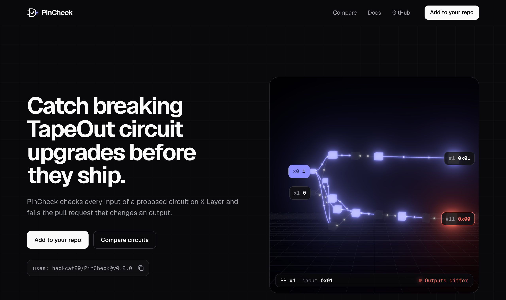
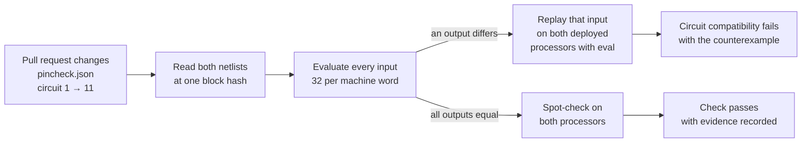
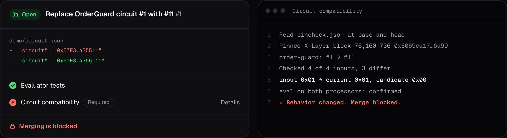
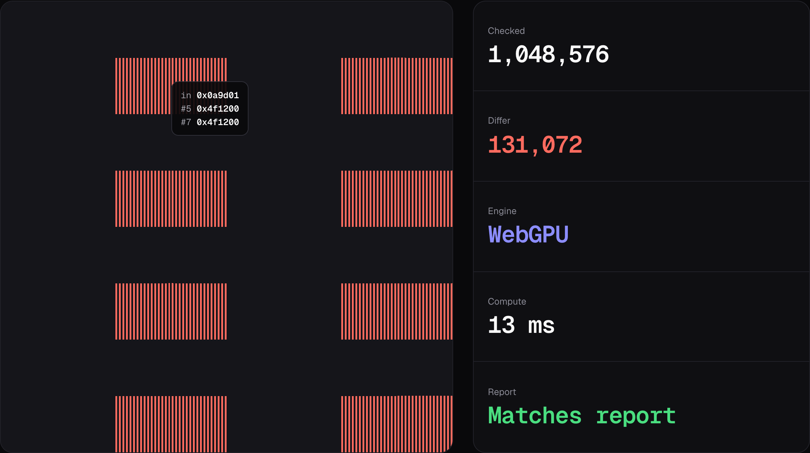
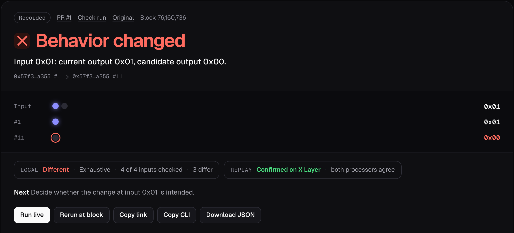

<p align="center">
  <picture>
    <source media="(prefers-color-scheme: dark)" srcset="docs/readme/logo-dark.svg">
    
  </picture>
</p>

<h1 align="center">PinCheck</h1>

<p align="center"><b>Catch breaking TapeOut circuit upgrades before they ship.</b></p>

<p align="center">
  <a href="https://pincheck.kiwiprotocol.workers.dev"></a>
  <a href="https://github.com/hackcat29/PinCheck/actions/workflows/check.yml"></a>
  <a href="#every-input-not-a-sample"></a>
  <a href="https://www.oklink.com/xlayer/address/0x1f09DAeFA827f02CBb40967cc91b259763760761"></a>
  <a href="#add-it-to-your-repository"></a>
</p>

<p align="center">
  <a href="https://pincheck.kiwiprotocol.workers.dev"><b>Live site</b></a> ·
  <a href="https://pincheck.kiwiprotocol.workers.dev/?example=orderguard-1-to-11#compare"><b>Try a comparison</b></a> ·
  <a href="https://pincheck.kiwiprotocol.workers.dev/docs"><b>Docs</b></a> ·
  <a href="#add-it-to-your-repository"><b>Install</b></a> ·
  <a href="https://pincheck.kiwiprotocol.workers.dev/llms.txt"><b>For agents</b></a>
</p>

<p align="center"></p>

**PinCheck is a required GitHub check for apps that call TapeOut circuits on X Layer.** Pin the circuits your app calls in `pincheck.json`. When a pull request swaps one for another, PinCheck evaluates every input of both circuits at one block hash, replays the first difference on the deployed processors, and blocks the merge with the exact input that proves the behavior changed.

It has already done this on a real upgrade: in [pull request #1](https://github.com/hackcat29/PinCheck/pull/1), OrderGuard circuit #11 answered `0x00` where #1 answered `0x01`, both processors confirmed it on mainnet, and the [required check failed](https://github.com/hackcat29/PinCheck/actions/runs/44116618733).

---

## The problem

A TapeOut app calls a circuit by address and ID, for example `0x57F3…a355:1`. Circuits are immutable, so apps "upgrade" by pointing at a new ID. In review that is a one-character diff, `:1` → `:11`, and nothing in it says which payments the new circuit now rejects, which game states it now allows, or whether it still takes the same inputs. The people who would notice are the users, after it ships.

## How it works



1. **Pin.** `pincheck.json` lists the circuits your app calls. The baseline is read from the pull request's base commit, the candidate from its head, both as data; no pull-request code runs.
2. **Compare.** Both circuits and everything they `REF` are read at one block hash, checked against the TAP-02 well-formedness rules, and evaluated on every input: up to 2^26 per check, bit-sliced 32 inputs at a time.
3. **Replay.** The first differing input is sent to both deployed processors with `eval`. If a processor disagrees with PinCheck, the result is Inconclusive, never a pass.
4. **Gate.** A required check named **Circuit compatibility** blocks the merge. An intended change is approved in the manifest with `acceptChange` and a reason, and still shows its counterexample.

## It already blocked a real upgrade

<p align="center"></p>

| Pull request | Change | Result | Evidence |
|---|---|---|---|
| [#1](https://github.com/hackcat29/PinCheck/pull/1) | OrderGuard #1 → #11 | **Blocked.** Input `0x01`: current `0x01`, candidate `0x00`; 3 of 4 inputs differ; both processors confirmed it | [check run](https://github.com/hackcat29/PinCheck/actions/runs/44116618733), [report](examples/orderguard-1-to-11.json) |
| [#2](https://github.com/hackcat29/PinCheck/pull/2) | OrderGuard #1 → #2 | **Passed.** Identical netlists, 4 of 4 inputs equal | [check run](https://github.com/hackcat29/PinCheck/actions/runs/44116681813), [report](examples/orderguard-1-to-2.json) |
| [#3](https://github.com/hackcat29/PinCheck/pull/3) · [#4](https://github.com/hackcat29/PinCheck/pull/4) · [#5](https://github.com/hackcat29/PinCheck/pull/5) | The same changes through the released GitHub Action | Blocked · passed · intended change accepted with its reason shown | [runs](#verification-evidence) |

## Every input, not a sample

<p align="center"></p>

The site evaluates all 1,048,576 inputs of two 20-input Neon Reliquary chips in your browser with a WebGPU compute shader ([TypeGPU](https://docs.swmansion.com/TypeGPU)), falls back to the CPU without WebGPU, and checks that both find the 131,072 differing inputs PinCheck recorded. Hover any cell to see both circuits' outputs for that input.

**How much of X Layer can PinCheck prove today?** [`scripts/census.mjs`](scripts/census.mjs) read every circuit on every processor registered with the X Layer TapeOut factory at one block hash ([`docs/census.json`](docs/census.json), block 76,176,872):

| Circuits | Share | What PinCheck gives for an upgrade |
|---:|---:|---|
| 8,230 | 71.0% | Exhaustive proof in the web workbench, the CLI and the Action |
| 61 | 0.5% | Exhaustive proof in the CLI and the Action, beyond the web workbench's limits |
| 3,005 | 25.9% | Stateful (LATCH): proof only when the netlists are byte-identical |
| 267 | 2.3% | Too wide to enumerate: identical-netlist proof or a sampled counterexample |
| 23 | 0.2% | Larger than PinCheck evaluates (over 20,000 gates) |
| **11,586** | | **on 218 of 426 processors: 8,291 (71.6%) exhaustively provable, and 96.9% of the stateless circuits within PinCheck's size limits** |

## Add it to your repository

Three files and one branch rule. No account, token or service. The full guide is [docs/install.md](docs/install.md).

```yaml
# .github/workflows/pincheck.yml
name: PinCheck
on:
  pull_request:
  merge_group:
permissions:
  contents: read
jobs:
  pincheck:
    name: Circuit compatibility
    runs-on: ubuntu-latest
    timeout-minutes: 10
    steps:
      - uses: hackcat29/PinCheck@v0.2.0
        with:
          manifest: pincheck.json
```

```json
{ "pincheck": 1, "dependencies": { "order-guard": { "circuit": "0x57F319CF056F72F48cF1dbb670F2A3DB007Aa355:1" } } }
```

Then add `.github/CODEOWNERS` for `pincheck.json` and `.github/workflows/`, and a branch ruleset that requires **Circuit compatibility** from GitHub Actions and code-owner review. [examples/consumer](examples/consumer) is the complete layout. The workflow needs only `contents: read`, works on fork pull requests, and never uses `pull_request_target`.

> **Release status.** v0.2.0 is the first release that includes the GitHub Action. Before release it was verified on GitHub both installed by commit and run from the base commit, in pull requests [#3](https://github.com/hackcat29/PinCheck/pull/3) (blocked), [#4](https://github.com/hackcat29/PinCheck/pull/4) (passed) and [#5](https://github.com/hackcat29/PinCheck/pull/5) (intended change accepted). For the strongest pin, replace `@v0.2.0` with the tag's full commit SHA.

## Try it

- **In the browser:** [the workbench](https://pincheck.kiwiprotocol.workers.dev/#compare) opens on the recorded PR #1 evidence, reruns it live on mainnet, compares any two circuits, and opens a saved report (including the `pincheck-report` artifact from a GitHub run) without an RPC.
- **From the command line** (Node.js 22+, no dependencies):

  ```sh
  git clone https://github.com/hackcat29/PinCheck && cd PinCheck
  node cli.mjs 0x57F319CF056F72F48cF1dbb670F2A3DB007Aa355:1 0x57F319CF056F72F48cF1dbb670F2A3DB007Aa355:11
  ```

  It prints a JSON report and exits `0` (compatible), `1` (behavior or interface changed) or `2` (inconclusive or invalid input). Add `--block <hash>` to reproduce a report exactly.

<p align="center"></p>

## What a pass means

**Compatible** means every one of the 2^n inputs produces the same output bits from both circuits under [TAP-02](https://github.com/TapeOutProtocol/TAPs/blob/main/TAPs/TAP-02.md) evaluation, at the recorded block, with inputs and outputs packed least significant bit first. Byte-identical netlists are compatible for every input and state.

It does not show that either circuit is correct, that the bits mean the same thing to your app, or that behavior will hold after the processor implementation changes (TapeOut processors are beacon proxies and the X Layer factory is not sealed). Each report records what it read so another maintainer can reproduce it:

- chain ID, block number, hash and timestamp; calls pinned with [EIP-1898](https://eips.ethereum.org/EIPS/eip-1898) block hashes (`requireCanonical`), falling back to block number plus a hash recheck only when an RPC rejects them;
- both processors' registration with the X Layer factory, the factory's sealed flag, and the circuit implementation behind the beacon;
- every circuit in both REF closures with dimensions, gate count, SHA-256 and Keccak-256 of the netlist bytes;
- local comparison and on-chain replay as separate statuses, with explicit coverage, and the PinCheck version.

A processor that disagrees with PinCheck makes the result **Inconclusive**. A replay that cannot run never hides a local mismatch. An RPC failure is **Inconclusive** and blocks the merge; it can never pass.

## Why this needs TapeOut

Checking that two programs behave the same is undecidable in general, which is why smart-contract upgrades are reviewed by people and tested by samples. TapeOut makes it a finite, exact question:

- **Circuits are pure netlists with published semantics.** A TAP-02 circuit is NAND, LATCH and REF records with fixed bit packing, so its whole behavior is a function of its input bits. For a stateless circuit with up to 26 inputs, PinCheck can check every one of them, so a pass is a proof, not a test.
- **The chain runs the same semantics.** Every processor exposes `eval`, so a counterexample is not PinCheck's word against yours: anyone can send that input to both deployed circuits and get the same two answers.
- **Circuits are immutable and addressed by ID.** A pin means something, and a change of pin is exactly the event to review. What can still change, the processor implementation behind the beacon, is recorded in every report.
- **Teams already publish netlist hashes.** PinCheck's fingerprints match the Keccak-256 hashes [Neon Reliquary](https://github.com/tizerluo/neon-reliquary-xlayer/blob/main/docs/XLAYER-MAINNET.md) and [Fusebox](https://github.com/0xdopewilly/fusebox/blob/main/circuits/build/fuses.json) list for their circuits.

## Who it's for

| Who | What they risk today | What PinCheck gives them |
|---|---|---|
| **Apps that call circuits**: payment guards, games, scoring, indicators | Switching a circuit ID silently changes what the app approves or computes | A required check that blocks the change and names the input that proves it |
| **Circuit authors and markets**: teams publishing new versions or rival designs for the same interface | Users install a replacement without knowing where it decides differently | The exact inputs where two designs differ, in the author's own pin names. For Fusebox's unreleased Per-Payment Cap vs the deployed Daily Cap, all 16,777,216 inputs were checked and the first difference is amount 0, spent 1, cap 0 |
| **Reviewers and auditors** | A one-line diff with no behavioral evidence attached | A reproducible report: block hash, fingerprints, implementation and coverage |
| **AI agents** | No way to check a circuit change before acting on it | A JSON API, a CLI with exit codes and [`/llms.txt`](https://pincheck.kiwiprotocol.workers.dev/llms.txt) |

**How it reaches them.** TapeOut is a small ecosystem whose builders are reachable by name. The first design partners are maintainers who already pin circuits in public repositories: wallet guards, game chips and market indicators found while building PinCheck. The offer is to install the check on a real upgrade for free and measure time to the first reproduced result and whether they run it again on the next change.

## Business model

PinCheck is free today: the GitHub Action, the CLI and the public workbench. Revenue is a hypothesis being tested with design partners, not a claim. The candidates are:

- **Private evidence.** Compare circuits before they are taped out, without publishing the netlist: what a circuit author needs before paying to tape out a rival design.
- **Release history.** A per-repository record of which circuit version was approved, by whom and why, across every upgrade.
- **Monitoring across repositories.** Alerts when a circuit you depend on, or the processor implementation behind it, changes anywhere.

There is no revenue yet. The next milestone is one external team installing PinCheck and the check catching or approving a real change.

## For AI agents

- [`/llms.txt`](https://pincheck.kiwiprotocol.workers.dev/llms.txt) describes the API, the CLI and how to read a report.
- `GET /api/compare?baseline=<processor>:<id>&candidate=<processor>:<id>[&block=<hash>]` returns a JSON report (schema 2): `status`, a machine-readable `code` for inconclusive results, coverage, the counterexample, replay status and everything that was read. HTTP 429 with `Retry-After` when busy.
- `node cli.mjs ...` exits `0`, `1` or `2`, and `node cli.mjs gate` runs the release gate on two manifests.
- The GitHub Action exposes `decision`, `exit-code` and `report` outputs and uploads the JSON report even when the check fails.

## At a glance

| | |
|---|---|
| Live site | [pincheck.kiwiprotocol.workers.dev](https://pincheck.kiwiprotocol.workers.dev) (Cloudflare Workers) |
| GitHub Action | `hackcat29/PinCheck@v0.2.0`, required check **Circuit compatibility** |
| Chain | X Layer mainnet, chain 196 |
| TapeOut contracts read | Factory [`0x1f09…0761`](https://www.oklink.com/xlayer/address/0x1f09DAeFA827f02CBb40967cc91b259763760761), circuit beacon `0xf70d…991C`, implementation `0x977f…29b2` |
| Circuits in the evidence | OrderGuard [`0x57F3…a355`](https://www.oklink.com/xlayer/address/0x57F319CF056F72F48cF1dbb670F2A3DB007Aa355) #1, #2, #5, #9, #11 and Fusebox fuses #15-#18; Neon Reliquary [`0x57E9…1A44`](https://www.oklink.com/xlayer/address/0x57E9e1111f42F448126A9F12b2b3f99a79dd1A44) #5, #7, #9, #10; all 11,586 circuits in the census |
| TapeOut features used | `netlist`, `circuitInfo`, `eval`, processor `nextId`; factory `isCPU`, `cpuCount`, `cpuAt`, `isSealed`; beacon `implementation`; TAP-02 NAND, REF and LATCH decoding |
| Rendering | three.js `WebGPURenderer` (WebGL 2 fallback) for the 3D netlists, TypeGPU for the input-space compute |
| Tests | 63 deterministic and 6 mainnet smoke tests, in CI on every pull request |

## Status and limits

- Exhaustive checks cover up to 24 input bits in the web workbench and 26 in the CLI and Action, within 20,000 gates per circuit, 512 KB per netlist and 16 levels of REF.
- Wider circuits are sampled with a fixed seed: a sampled mismatch fails the check, but a clean sample is **Inconclusive**, never a pass. Circuits with 32 to 64 inputs, such as market indicators, need a SAT-based equivalence proof, which is the next evaluator milestone.
- Stateful (LATCH) circuits pass only when byte-identical.
- X Layer mainnet (chain 196) only. Comparing a deployed circuit with a netlist that is not taped out yet is not in the CLI yet.
- Intended changes are approved in the manifest with `acceptChange`, bound to the exact circuit transition and shown in every summary; an acceptance can never override a run that failed.

## Repository

<details>
<summary><b>Layout</b></summary>

| Path | Contents |
|---|---|
| `src/compare.mjs` | TAP-02 decoding, well-formedness checks, REF inlining, bit-sliced exhaustive and sampled comparison. No I/O. |
| `src/xlayer.mjs` | X Layer reads: pinning, factory registration, implementation, replay, RPC limits and redaction |
| `src/manifest.mjs`, `src/gate.mjs`, `src/summary.mjs` | `pincheck.json`, the release gate, the GitHub job summary |
| `src/report.mjs` | Decision, coverage, guarantee and next-step wording shared by the CLI, summary and browser |
| `action.yml`, `action/` | The composite GitHub Action |
| `server.mjs`, `web/` | Site, workbench and docs (Node) |
| `src/api.mjs`, `worker.mjs`, `wrangler.jsonc` | The HTTP API shared by Node and Cloudflare, and the Worker that serves it with the static site built by `scripts/build-site.mjs` |
| `web/landing/` | Landing page modules: the 3D netlist scene (three.js), the input-space map (TypeGPU), and the shared netlist evaluator they use |
| `web/vendor/` | three.js 0.187, TypeGPU 0.12 and the Geist fonts, bundled and served by PinCheck itself. Rebuild with `npm run vendor`; hashes and licenses are recorded next to them |
| `scripts/` | `vendor.mjs` rebuilds `web/vendor`; `record-netlists.mjs` rereads the example netlists from X Layer and checks them against the recorded fingerprints; `census.mjs` reads every circuit on X Layer into `docs/census.json`; `build-site.mjs` builds `dist/` for Cloudflare |
| `examples/` | Recorded schema 2 reports with provenance, their netlists, and the consumer repository layout |
| `demo/` | The schema 1 reports captured by the original GitHub checks, and the manifest PRs #1 and #2 change |

</details>

<details>
<summary><b>Run, test and deploy</b></summary>

Node.js 22 or newer. PinCheck has no runtime dependencies; `wrangler` is a dev dependency used only to deploy.

```sh
npm start                     # site and API on http://localhost:4173
npm test                      # deterministic tests, no network
npm run test:live             # X Layer mainnet smoke tests
npm run deploy                # build dist/ and deploy to Cloudflare Workers
node scripts/census.mjs       # reread every circuit on X Layer into docs/census.json
```

Set `X_LAYER_RPC` for another endpoint; credentials in it never appear in output. Deployment, environment variables, health checks and the RPC outage runbook are in [docs/deploy.md](docs/deploy.md).

</details>

## Verification evidence

Every check below was run on 2026-11-17 for v0.2.0 and passed, or returned the result it was designed to return. Mainnet runs read X Layer through `https://rpc.xlayer.tech`. Block numbers are given where the run was pinned or recorded; the rest ran at the latest block, and a `--block` hash reproduces any of them while the RPC keeps that state.

<details>
<summary><b>Deterministic tests (npm test, no network)</b></summary>

63 of 63 pass locally; the 55 that existed at v0.2.0 also pass in GitHub Actions.

| File | Tests | Covers |
|---|---|---|
| `test/compare.test.mjs` | 17 | NAND/REF semantics, multi-output REF order, LSB-first packing, interface mismatch, malformed and self-referencing netlists, undeclared state, gate-count mismatch, 2^20 and 2^22 exhaustive search (a single differing input among 4,194,304 found exactly), sampling that can fail but never pass, identical stateful circuits, size and REF-depth limits |
| `test/xlayer.test.mjs` | 20 | Replay ABI encoding, EIP-1898 pinning and its fallback, spot-checks, replay disagreement, replay unavailable after a real mismatch, RPC down, wrong chain, unregistered processor, missing circuit, reorg during a run, historical state errors, credential redaction, response size cap, input parsing, bounded retries on rate limits |
| `test/gate.test.mjs` | 13 | Manifest validation, legacy manifests, pass/fail/inconclusive exit codes, acceptChange bound to one transition and refused for failed runs, added/removed/multiple dependencies, summary content with bit names, CLI exit codes |
| `test/web.test.mjs` | 4 | Landing-page evidence matches the recorded report, recorded examples match the captured v0.1 fingerprints, Markdown escaping, server validation, 429 under load and cache hits |
| `test/docs.test.mjs` | 4 | Install snippets, README, example layout and ruleset stay in sync |
| `test/site.test.mjs` | 5 | Recorded netlists match report fingerprints, the browser evaluator reproduces every recorded mismatch count, GPU program layout, vendored file hashes, static routes and path rejection |

</details>

<details>
<summary><b>GitHub Actions</b></summary>

| Run | Commit | Result |
|---|---|---|
| [Push to main](https://github.com/hackcat29/PinCheck/actions/runs/44129826650) | `e670742` (v0.2.0) | Evaluator tests and mainnet smoke tests passed |
| [PR #3](https://github.com/hackcat29/PinCheck/pull/3), #1 → #11 | `ec42162` | [Circuit compatibility](https://github.com/hackcat29/PinCheck/actions/runs/44129125420) and [the installed action](https://github.com/hackcat29/PinCheck/actions/runs/44129124752) **blocked the merge**, as intended; evaluator and smoke tests passed |
| [PR #4](https://github.com/hackcat29/PinCheck/pull/4), #1 → #2 | `861d61d` | [Circuit compatibility](https://github.com/hackcat29/PinCheck/actions/runs/44129130478) and [the installed action](https://github.com/hackcat29/PinCheck/actions/runs/44129130390) passed; evaluator and smoke tests passed |
| [PR #5](https://github.com/hackcat29/PinCheck/pull/5), #1 → #11 with acceptChange | `3f4fa42` | [Circuit compatibility](https://github.com/hackcat29/PinCheck/actions/runs/44129139534) and [the installed action](https://github.com/hackcat29/PinCheck/actions/runs/44129139738) passed with the change marked accepted; evaluator and smoke tests passed |
| [PR #1](https://github.com/hackcat29/PinCheck/pull/1) and [PR #2](https://github.com/hackcat29/PinCheck/pull/2) (v0.1) | | [Failed](https://github.com/hackcat29/PinCheck/actions/runs/44116618733) and [passed](https://github.com/hackcat29/PinCheck/actions/runs/44116681813) |

The `pincheck-report` artifacts downloaded from the first runs of PRs #3 and #5 contained `decision: fail`, exit code 1, input `0x01` with replay confirmed (#3), and `decision: pass` with the acceptChange reason recorded (#5). The artifacts were uploaded even though the job failed, with 90-day retention. The unchanged `demo/circuit.json` gate passed in the same runs.

</details>

<details>
<summary><b>X Layer mainnet comparisons (CLI and workbench)</b></summary>

| Comparison | Block | Result | Coverage | First mismatch: input → current, candidate | Replay |
|---|---|---|---|---|---|
| OrderGuard #1 → #11 | 76,160,736 (recorded) | Behavior changed | 4 of 4, 3 differ | `0x01` → `0x01`, `0x00` | Confirmed |
| OrderGuard #1 → #2 | 76,160,736 (recorded) | Compatible | 4 of 4, identical netlists | | 3 spot-checks confirmed |
| OrderGuard #1 → #11 | latest (several runs, e.g. 76,163,331 and 76,163,784) | Behavior changed | 4 of 4 | `0x01` → `0x01`, `0x00` | Confirmed |
| OrderGuard #5 → #9 | latest | Behavior changed | 16 of 16, 3 differ | `0x05` → `0x01`, `0x00` | Confirmed |
| Neon Reliquary #5 vs #7 (20 in, 22 out) | 76,163,385 (recorded) | Behavior changed | 1,048,576 of 1,048,576, 131,072 differ | `0x108001` → `0x4f1201`, `0x4f1202` (bits 16, 17) | Confirmed |
| Neon Reliquary #9 vs #10 | latest | Behavior changed | 1,048,576 of 1,048,576, 196,608 differ | `0x008401` → `0x4f1200`, `0x4f1210` (bit 20) | Confirmed |
| Fusebox Daily Cap #15 vs itself (24 in) | 76,165,405 | Compatible | 16,777,216 of 16,777,216 | | Spot-checks confirmed |
| Fusebox Payee Guard #16 vs itself (33 in) | 76,165,412 | Compatible | Identical netlists, all 2^33 inputs | | Spot-checks confirmed |
| Fusebox Breaker #17 vs itself (LATCH) | 76,165,418 | Compatible | Identical netlists, every input and state | | Not applicable (stateful) |
| Fusebox Two of Three #18 vs itself (19 in) | 76,165,481 | Compatible | 524,288 of 524,288 | | 3 spot-checks confirmed |
| Fusebox #15 → #18 | latest | Interface mismatch | 24 vs 19 input bits | | Not applicable |
| OrderGuard #1 → #999999 | latest | Inconclusive (`no-circuit`) | | | Not run |
| Unregistered contract → OrderGuard #1 | latest | Inconclusive (`unregistered-processor`) | | | Not run |

The recorded OrderGuard reports were reproduced at block hash `0x5069ea17…6a99` with the same SHA-256 netlist fingerprints as the reports captured by the v0.1 checks (`91c81eb0…` for #1 and #2, `c4324090…` for #11). Re-running all three recorded examples at their pinned hashes changed only the timestamp and wording fields.

**Netlist fingerprints match what projects publish.** PinCheck's Keccak-256 for Neon Reliquary chip #5 equals the hash in their [XLAYER-MAINNET.md](https://github.com/tizerluo/neon-reliquary-xlayer/blob/main/docs/XLAYER-MAINNET.md) (`0xe7817e01…0b02`). For Fusebox, the hashes of #15, #16, #17 and #18 equal those listed for `daily-cap`, `payee-guard`, `breaker` and `approval-2of3` in their [`circuits/build/fuses.json`](https://github.com/0xdopewilly/fusebox/blob/main/circuits/build/fuses.json): `0xd65b2e8a…dd97`, `0x2d1dc771…9099`, `0xb3a4fd12…f4ea`, `0x1236c24f…5027`.

**Fusebox rival fuses.** Fusebox's unreleased rival designs, taken from their `circuits/build/rivals.json` (not on chain, so the rival side cannot be replayed), were compared with the deployed fuses using PinCheck's evaluator through a one-off script, since the CLI cannot yet compare a deployed circuit with a local netlist:

- Per-Payment Cap vs Daily Cap #15: all 16,777,216 inputs, 5,592,320 differ. The first is amount 0, spent 1, cap 0: #15 denies and the rival approves.
- Lead Approver vs Two of Three #18: all 524,288 inputs, 32,640 differ. The first is approvers 2 and 3, amount 1, threshold 0: #18 approves and the rival denies.
- Strict Payee Book vs Payee Guard #16 (33 inputs): a sampled counterexample at `0x3dc841d001`, so the check fails without a full proof.
- Two-Strike Breaker vs Breaker #17: Inconclusive, because the circuits are stateful and not identical.

</details>

<details>
<summary><b>Mainnet smoke tests (npm run test:live)</b></summary>

6 of 6 pass in about 48 seconds locally, and in the GitHub runs for PRs #3 to #5 and the push to main: PR #1 and #2 conclusions reproduced at the recorded block, the regression still present at the latest block, Neon Reliquary 20-input exhaustive check with matching Keccak, Fusebox #16 and #17 identical-netlist passes, and inconclusive results for an unregistered contract and a missing circuit.

</details>

<details>
<summary><b>X Layer RPC and contract facts</b></summary>

Checked directly against `rpc.xlayer.tech`:

- `eth_call` accepts EIP-1898 `{ blockHash, requireCanonical: true }` and rejects an unknown block hash with "block not found".
- State at the recorded block 76,160,736 is still served. A call before the processor existed returns empty data.
- The factory `0x1f09…0761` reports `isCPU` true for OrderGuard and false for an arbitrary address, 426 processors, and `isSealed` false.
- The circuit beacon `0xf70d…991C` returns implementation `0x977f…29b2`, the address TAP-10 lists.
- `circuitInfo` for a missing circuit reverts with `no circuit`.
- The function selectors PinCheck uses, recomputed with Keccak-256, match the values published in TAP-02. PinCheck's Keccak-256 passes the standard empty-string and `abc` vectors and agrees with an independent implementation across block boundaries.

</details>

<details>
<summary><b>Release gate, end to end</b></summary>

- **The action's scripts, run locally against the real GitHub API at the SHAs of PRs #1 and #2:** `decision=fail`, exit 1 with the counterexample summary, and `decision=pass`, exit 0.
- **A fresh repository set up by copying each snippet from `docs/install.md`:** the documented sanity command returned compatible. A simulated #1 → #2 pull request passed with exit 0. #1 → #11 blocked with exit 1 and the counterexample. #1 → #11 with the documented acceptChange passed as "Behavior changed (accepted)" with the reason.
- **A live gate run of #1 → #11:** produced the job summary shown in [docs/install.md](docs/install.md#what-you-will-see).

</details>

<details>
<summary><b>Workbench and server (v0.2.0 site, before the redesign)</b></summary>

Checked with Playwright (Chromium) and axe-core 4.10 at 1280 px and 390 px, in light and dark mode:

- **Accessibility:** no axe violations (WCAG 2.0, 2.1 and 2.2 A/AA rules plus best practices) on the landing page or the docs.
- **Layout:** no horizontal scrolling, and the real counterexample is visible above the fold at both widths. No touch target is under 24 px.
- **Keyboard:** a logical tab order with a 3 px focus ring. Activating an example with the keyboard moves focus to the decision.
- **Actions:** Copy link and Copy CLI command copy the right text. Download JSON saves the full report. Opening the captured v0.1 report renders it, and a non-report file is rejected with a clear message. Empty form fields are flagged and focused.
- **Live runs:** a live #1 → #11 comparison completed in 6.4 to 6.9 seconds. Reloading its permalink was answered from cache in 21 to 24 ms. A missing circuit, an unregistered processor and an interface mismatch each showed their own decision and next step.
- **Server:** every route returned the expected status and content type. Bad input got 400, an unknown path 404, and a POST 405, and the CSP header is set. The deep health check confirmed chain 196.
- **RPC outage:** with an unreachable RPC URL containing a key, the deep health check returned 503, comparisons returned Inconclusive, and the key appeared in neither the response nor the server log.
- **Production launch:** `NODE_ENV=production HOST=0.0.0.0 PORT=8080 node server.mjs` served the site and docs.

</details>

<details>
<summary><b>Site rendering and GPU compute</b></summary>

Checked on 2026-11-17 with Playwright in headless Chrome (WebGPU on Apple Metal) and in headless Chromium without a WebGPU adapter:

- **Hero:** the hero renders the real OrderGuard #1 and #11 netlists with three.js on WebGPU, and on WebGL 2 when no adapter exists. Flipping input `x1` with the mouse or the keyboard changes the input to `0x03` or `0x02`, and both outputs update from the real netlists.
- **Input map:** TypeGPU evaluates all 1,048,576 inputs of Neon Reliquary #5 vs #7 on the GPU in 57 to 151 ms and finds 131,072 differing inputs, the count in the recorded report. Without WebGPU, the CPU path computes the same 131,072 in about 10 ms. Hovering or pressing N shows real outputs for any input, for example `0xb0a501`: #5 `0x4f1201`, #7 `0x4f1202`.
- **Accessibility and layout:** no axe-core violations on the landing page or docs at 1440 px and 390 px. Neither width has horizontal scrolling or a touch target under 24 px. With reduced motion, all content is visible.
- **Tests:** the netlists, the browser evaluator's counts, the GPU program layout, vendored file hashes and the new static routes are covered by `test/site.test.mjs`.

</details>

<details>
<summary><b>Production on Cloudflare Workers</b></summary>

Checked on 2026-11-17 at https://pincheck.kiwiprotocol.workers.dev (Worker startup 6 ms):

- **Health:** `/api/health?deep=1` reports chain 196.
- **PR examples:** #1 → #11 is Behavior changed (input `0x01`, replay confirmed). #1 → #2 at the recorded block hash is Compatible.
- **Heavy comparisons:** Neon Reliquary #5 vs #7 checks 1,048,576 inputs, 131,072 differ, replay confirmed. Fusebox #15 vs itself checks all 16,777,216 inputs and is Compatible. #15 → #18 is Interface mismatch.
- **Rate limiting:** the public RPC rate-limited about one comparison in three from Cloudflare's network until PinCheck retried HTTP 429/502/503/504 and JSON-RPC rate-limit errors. A burst of eight back-to-back comparisons then all completed. A permanently rate-limited RPC still ends Inconclusive after at most three attempts per call (covered by tests).
- **Browser suite:** the same suite as above passed against production, with WebGPU and GPU compute, the WebGL 2 and CPU fallback, and no axe violations at 1440 px and 390 px.
- **Headers and compression:** static files carry the same CSP and security headers through `_headers`, and three.js is served Brotli-compressed (about 317 KB).

</details>

<details>
<summary><b>Evaluator speed</b></summary>

Two comparisons of every input, locally, before chain reads:

| Input bits | Gates (both circuits) | Time |
|---|---|---|
| 20 | 102 | 16 ms |
| 24 | 218 | 308 ms |
| 24 | 434 | 523 ms |
| 26 | 402 | 1,980 ms |

</details>

<details>
<summary><b>Not yet verified</b></summary>

- A Docker image build: the Docker daemon was not running.
- A pull request from a fork: GitHub does not allow forking your own repository.
- Creating the ruleset from `examples/consumer/ruleset.json`: this was not applied, to avoid changing repository settings.
- A `merge_group` run.
- How GitHub renders the job summary: summaries are not visible to signed-out browsers. The Markdown itself is covered by tests.
- A workflow that uses `@v0.2.0` by tag: the tag resolves and serves `action.yml`, but runs so far used the commit SHA.

</details>

## Credits and references

- [TAP-02](https://github.com/TapeOutProtocol/TAPs/blob/main/TAPs/TAP-02.md): netlist encoding, evaluation semantics and processor interface. X Layer contract addresses are from TAP-10 and were read back on chain.
- Example circuits come from public deployments PinCheck does not own: the [OrderGuard processor used by Fusebox](https://github.com/0xdopewilly/fusebox#live-on-x-layer-mainnet-chain-196) and [Neon Reliquary](https://github.com/tizerluo/neon-reliquary-xlayer/blob/main/docs/XLAYER-MAINNET.md).
